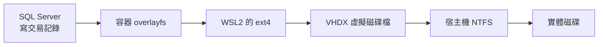

# Testcontainers.MsSql 整合測試問題排解（一）：seed data 寫入逾時的判讀與 tmpfs 設定

用 `Testcontainers.MsSql` 跑整合測試，在塞 seed data 的時候偶發逾時：這次失敗、重跑就過。
這篇整理逾時的判讀方式，以及目前範例採用的 tmpfs 與資料庫設定。只想看設定的話，直接跳第五節。

## 一、問題現象

錯誤是這一句：

```text
執行逾時到期。在作業完成之前超過逾時等待的時間，或是伺服器未回應。
```

抓到的是 `SqlException`，`Number` 為 `-2`。

光有這句話不夠，因為逾時的原因太多。當時觀察到三個特徵：

第一，發生在 Arrange 階段塞 seed data 的時候，而且是一筆一筆的小 INSERT。第二，它是偶發的：
同一份程式碼，這次失敗、下次全過，失敗的位置還不固定。第三，**有時候第一個測試都還沒開始跑就中了**，
錯在初始化那批資料。

這些特徵能幫助決定排查方向，但無法單獨證明原因。即使現象相同，也要先確認逾時發生在哪個階段。

## 二、先讀懂錯誤訊息

排查的第一步不是查伺服器，是確認自己看的是哪一種逾時。`Microsoft.Data.SqlClient` 有好幾句
措辭相近的訊息，指的卻是完全不同的事。以下三種原文取自範例使用的 7.1.1 資源字串，原本各是一行，
這裡為版面折行；句號後面是兩個空白，那是原文就有的。

**指令逾時**（資源 key `SQL_Timeout_Execution`），`Number` 是 `-2`：

```text
Execution Timeout Expired.  The timeout period elapsed prior to completion of the
operation or the server is not responding.
```

```text
執行逾時到期。在作業完成之前超過逾時等待的時間，或是伺服器未回應。
```

這句出現在指令執行階段，執行或等待回應超過逾時限制。當時 seed data 遇到的是這一種，
但訊息本身還不能說明等待發生在鎖、I/O 或其他地方。

**連線集區逾時**（`ADP_PooledOpenTimeout`）：

```text
Timeout expired.  The timeout period elapsed prior to obtaining a connection from
the pool.  This may have occurred because all pooled connections were in use and
max pool size was reached.
```

連線根本還沒拿到，通常代表你有連線沒關、或是同時開太多。排查方向跟前者完全相反：
前者往「伺服器為什麼慢」查，後者往「我的連線是不是漏了」查。

**登入前交握逾時**（`SQL_Timeout_PreLogin_ConsumeHandshake`）：

```text
Connection Timeout Expired.  The timeout period elapsed while attempting to consume
the pre-login handshake acknowledgement.  This could be because the pre-login
handshake failed or the server was unable to respond back in time.
```

TCP 連得上，卡在後面的 TDS 交握。這一種要先查連線路徑、伺服器回應及本機網路防護，
與大量 seed 的寫入逾時分開處理。[系列（二）](testcontainers-mssql-toolchain-traps.md#補充windows-上的登入前交握逾時)
有一小段本機 AdGuard 設定的說明。

### 容易誤認的第四句

在 7.0.2 的中文資源中，還有第四句，長得跟指令逾時幾乎一樣：

```text
已超過連接 Timeout 的設定。在作業完成之前超過逾時等待的時間，或者是伺服器未回應。
```

後半句跟指令逾時只差「或是」與「或者是」兩個字，但它是**連線**層級的逾時。
這句在資源中的 key 是 `SQL_Timeout`，英文原文如下：

```text
Timeout expired.  The timeout period elapsed prior to completion of the operation
or the server is not responding.
```

跟指令逾時的英文只差開頭那個 `Execution`。這是 7.0.2 的歷史訊息；查核 7.1.1 的資源時，
已找不到 `SQL_Timeout` 這個 key，不能將它當成每個版本都會使用的訊息，見
[SqlClient 7.1.1 資源原始碼](https://github.com/dotnet/SqlClient/blob/v7.1.1/src/Microsoft.Data.SqlClient/src/Resources/Strings.resx)。

判讀時先看完整訊息，再看例外發生在 `OpenAsync` 還是 `ExecuteAsync`，以及堆疊與階段耗時。
`SqlException.Number == -2` 不能單獨區分兩者：當時記錄的登入前交握失敗也是 `-2`。
只用錯誤編號判定指令逾時，會把連線問題帶往錯誤的排查方向。

## 三、先檢查連線、平行執行與交易

當時先檢查連線集區、xUnit 平行執行與未提交交易，再評估 I/O 與資源壓力。

**連線集區耗盡。** 當時收到的是執行指令的逾時訊息，與等待取得集區連線的訊息不同，因此先排除這個方向。

**xUnit 平行測試互相競爭。** 這個要實際確認，而且有個很多人會踩的誤解：xUnit 的
**collection 之間預設是平行執行的**。更麻煩的是，沒有掛 `[Collection]` 屬性的測試類別，
每一個都會自成一個「隱含 collection」。你以為它們排隊跑，其實它們在搶同一顆資料庫。

三十秒的驗證法：去看測試專案裡的 `xunit.runner.json`。

```json
{
  "$schema": "https://xunit.net/schema/current/xunit.runner.schema.json",
  "parallelMode": "none",
  "parallelizeTestCollections": false,
  "diagnosticMessages": true
}
```

`parallelMode` 設成 `"none"`，會停用整個測試組件內的平行執行。它的預設值是 `"collections"`，
允許不同 collection 平行執行，同一個 collection 內仍循序執行。下面那個
`parallelizeTestCollections` 是 v2 的舊鍵，v3 4.0 起會自動對映到 `parallelMode`
（`true` 對 `"collections"`、`false` 對 `"none"`），而且不會覆寫明確設定的新鍵。
目前範例明確設定新鍵，並保留舊鍵。

確認過之後，這個假設也排除了。

**洩漏的未提交交易在持鎖。** 第一個測試開始前就失敗，能排除「前一個測試留下交易」的解釋，
但仍需檢查初始化流程本身有沒有開交易，以及是否有其他連線持鎖。不能只憑發生順序排除所有鎖等待。

**I/O 與資源壓力。** 大量小寫入與宿主機負載變動，使這個方向值得檢查。不過目前留存的資料
沒有直接證明原始偶發逾時是 `WRITELOG`；以下說明的是可能的機制與降低寫入成本的設定。

## 四、WRITELOG 等待與 WSL2 的寫入路徑

在 Windows 加 Docker Desktop（WSL2）上，容器的磁碟寫入會經過虛擬機的儲存路徑。
未另掛 volume 或 bind mount、使用容器 writable layer 時，可以用下面的圖理解：



volume、bind mount 與不同儲存後端的路徑會有差異，不能把這張圖套到所有容器。
宿主機的磁碟負載與防毒檢查可能影響延遲；是否真的影響當次測試，需要量測或採證才能確認。

對需要完整耐久性（durability）的交易，SQL Server 在回應 commit 前必須完成交易記錄寫入。
等待交易記錄 flush 的等待型別是 `WRITELOG`。使用 delayed durability 時，commit 的回應時機不同。

沒有共用交易的一筆一筆 INSERT，會產生多次提交與交易記錄寫入。seed data 有幾百幾千筆時，
這類成本容易累積。tmpfs 與 delayed durability 分別調整儲存方式及提交時機，但設定生效不等於
已證明原始逾時的原因。

## 五、解決方式

目前範例使用 `Testcontainers.MsSql 4.16.0`，SQL Server 資料庫存取使用
`Dapper 2.1.89` 與 `Microsoft.Data.SqlClient 7.1.1`。

兩個地方要改。

第一，建立容器時把 SQL Server 預設的**資料庫檔案目錄**掛成 tmpfs：

```csharp
return new MsSqlBuilder(ImageName)
    // SQL Server on Linux 預設把使用者資料庫與系統資料庫的資料檔（.mdf/.ndf）
    // 和交易記錄檔（.ldf）都放在這個目錄。這才是與 WRITELOG 相關的掛載點。
    .WithTmpfsMount("/var/opt/mssql/data")
    // 記憶體預算：容器總量與 SQL Server 本體上限是兩層不同的東西，
    // 兩層都要設，理由見 ContainerMemoryBudget。必須排在 WithTmpfsMount 之後。
    .WithMemoryBudget()
    .Build();
```

tmpfs 是記憶體檔案系統。掛上之後，這個目錄主要由記憶體承載，避開一般的資料庫檔案磁碟寫入路徑。
但 Linux 仍可能把 tmpfs 頁面寫入 swap，不能保證永遠只寫進 RAM；這點在
[Docker tmpfs 文件](https://docs.docker.com/engine/storage/tmpfs/)也有說明。

這裡有一個很容易被目錄名稱誤導的地方：`/var/opt/mssql/log` **不是**資料庫交易記錄檔（`.ldf`）
的位置。它放的是 SQL Server error log、Extended Events 與 crash dump 等診斷資料，不在
`WRITELOG` 的寫入路徑上。SQL Server on Linux 的預設資料與交易記錄目錄都是
`/var/opt/mssql/data`，這點可以在 Microsoft 的
[`mssql-conf` 文件](https://learn.microsoft.com/sql/linux/configure/mssql-conf#change-the-default-data-or-log-directory-location)查到。

第二，建立測試資料庫之後補兩道設定：

```csharp
await connection.ExecuteAsync(
    $"""
     CREATE DATABASE [{DatabaseName}];
     ALTER DATABASE [{DatabaseName}] SET RECOVERY SIMPLE;
     ALTER DATABASE [{DatabaseName}] SET DELAYED_DURABILITY = FORCED;
     """,
    commandTimeout: 120);
```

`RECOVERY SIMPLE` 讓不再需要的交易記錄空間在 checkpoint 後可供重用，並不會自動縮小檔案。
長交易等因素仍可能延後回收、使檔案成長，見 [SQL Server 交易記錄說明](https://learn.microsoft.com/en-us/sql/relational-databases/logs/the-transaction-log-sql-server)。
`DELAYED_DURABILITY = FORCED` 讓交易 commit 不必等當次記錄 flush 完成才回應，代價是故障時可能遺失
已回應成功但尚未寫出的交易。這組設定用在可拋棄的測試資料庫。

這三項請當成一組設定看待。它們處理的是同一條寫入路徑上的不同環節，我沒有做過拆開來的
對照實驗，所以不能宣稱哪一項貢獻比較多。

### 實測結果

2026-08-24 在我自己機器上量的，各跑十輪，只切換 tmpfs、其餘設定不動。
環境是 Windows 11、Docker Desktop（WSL2）、`Engine 29.7.2`、`Testcontainers.MsSql 4.14.0`，
使用 `mcr.microsoft.com/mssql/server:2022-latest`，量測時機器閒置。整輪測試欄是中位數，
容器啟動欄沿用當時的彙整值：

| | 容器啟動 | 整輪測試中位數 |
| --- | --- | --- |
| tmpfs 開 | 6.01 秒 | 12.9 秒 |
| tmpfs 關 | 7.89 秒 | 14.7 秒 |

這組摘要中，容器啟動快約 24%，整輪快約 12%。它是當時版本的參考結果，不能直接當作現行範例
或其他機器的執行時間。

**這組數字顯示該次量測比較快，不能證明「比較穩」。** 兩組都是零失敗，沒有重現原始偶發逾時。
要比較失敗率與延遲變動，還需要在可控制的負載下做對照。

我在意的是偶發延遲能不能減少，不只是平均花多久。但上面這張表只能回答該次量測的執行時間，
不能回答原始失敗率是否下降。

## 六、確認掛載是否生效

這一步不要跳過。tmpfs 掛在錯誤的路徑上不一定會有錯誤訊息，測試照跑、容器照起，
只是設定完全沒有生效。

先確認掛載點：

```bash
docker exec <container> df -h /var/opt/mssql/data
```

```text
Filesystem      Size  Used Avail Use% Mounted on
tmpfs           512M  150M  363M  30% /var/opt/mssql/data
```

**看第一欄就好。** 是 `tmpfs` 就對了；顯示 `overlay` 代表沒掛上。`Size` 那個 512M 是我設的，
下一節會講為什麼；沒設的話這裡會是可用記憶體的一半，在我的 WSL2 上是 16G。

但 `df` 只能證明「這個路徑是 tmpfs」，不能證明 `.ldf` 真的在這裡。再從 SQL Server 查一次：

```sql
SELECT type_desc, physical_name
FROM sys.database_files
ORDER BY file_id;
```

`ROWS` 的 `.mdf` 和 `LOG` 的 `.ldf` 都應該位於 `/var/opt/mssql/data/`。順便確認一下
`/var/opt/mssql/log` 的用途：

```sql
SELECT SERVERPROPERTY('ErrorLogFileName');
```

會得到 `/var/opt/mssql/log/errorlog`——那裡的 log 是診斷記錄，不是 transaction log。

範例專案把這兩個查詢寫成了測試，檔案位置不符預期時測試會失敗。

## 七、記憶體的代價

範例設定了兩層記憶體上限：容器總量，以及 SQL Server 行程本身。

**第一層是容器總量**，也就是 `docker run --memory` 那個 cgroup 上限。它要裝的不只是
SQL Server 的 buffer pool，還有執行緒堆疊、query workspace，**以及 tmpfs 的檔案內容**。
最後這項是重點：tmpfs 的頁面算在容器的 memory cgroup 額度裡，你把資料庫搬進記憶體，
那些資料就是從容器的額度扣的。

**第二層是 SQL Server 行程自己**，環境變數 `MSSQL_MEMORY_LIMIT_MB`。注意是**三個底線**；
`mssql.conf` 裡的同名設定才是無底線的 `memorylimitmb`。依
[Microsoft 記憶體設定說明](https://learn.microsoft.com/en-us/sql/linux/configure/performance-best-practices-sql-server-memory?view=sql-server-ver17)，
SQL Server 2022 CU20 起支援 cgroup v2，未明確設定時使用主機記憶體與 cgroup 上限中較小值的 80%。
不能概括為 SQL Server 一律看不到容器額度。

保留兩層設定，是為了明確分配 SQL Server、tmpfs 與其他行程的額度。即使 SQL Server 能辨識 cgroup，
tmpfs 與其他行程也使用同一個容器上限，仍需要留出空間。

範例專案的預算是這樣分的：容器 4 GB ＝ SQL Server 本體 2.5 GB ＋ tmpfs 上限 512 MB
＋約 1 GB 給其餘行程與短暫尖峰。

### 當時將 SQL Server 上限設為 2048 MB 的結果

我原本設 2048，想說整合測試的資料量才幾百 MB，2 GB 的 buffer pool 綽綽有餘。結果連
`CREATE DATABASE` 都跑不完：

```text
There is insufficient system memory in resource pool 'default' to run this query.
```

`MSSQL_MEMORY_LIMIT_MB` 涵蓋的是 buffer pool、SQLPAL、query workspace 等元件的總額度，
不能只按測試資料大小估算。在當時的環境，2048 MB 無法完成建庫，2560 MB 可以；
我沒有再往下試更精確的邊界。這是該次環境的觀察，不是所有 SQL Server 版本的最低安全值。

### tmpfs 的大小上限得從別的地方設

`WithTmpfsMount` 只吃掛載路徑跟 access mode，沒有指定大小的多載，所以 size 要從
`WithCreateParameterModifier` 補。這裡有一個容易做白工的地方：本範例用 `WithTmpfsMount` 建立掛載時，把 tmpfs 放進
`HostConfig.Mounts`（`Type` 是 `tmpfs`），不是旁邊那個 `HostConfig.Tmpfs` 字典。
後者在這個建置流程中是 `null`。

我第一次就是寫去改 `HostConfig.Tmpfs`，沒有任何錯誤，`docker inspect` 出來 `Tmpfs` 也還是
`null`，看起來就像「設了但 Docker 不理我」。實際上是我對著一個空欄位做事。正確的做法是
走 `Mounts`：

```csharp
foreach (var mount in hostConfig.Mounts)
{
    if ("tmpfs".Equals(mount.Type, StringComparison.OrdinalIgnoreCase))
    {
        mount.TmpfsOptions = new TmpfsOptions { SizeBytes = TmpfsSizeLimitBytes };
    }
}
```

## 八、結語

目前範例把資料庫檔案放在 tmpfs，並明確設定提交方式與記憶體預算。這些設定已能執行，
歷史對照也顯示該次量測較快，但仍需把功能驗證、執行時間與偶發失敗的原因分開判斷。

遇到逾時時，先確認完整訊息與呼叫位置，再決定要查連線、交易還是儲存。
相近的措辭與相同的錯誤編號，可能出現在不同階段。

完整的範例專案在 [GitHub](https://github.com/kevintsengtw/MsSql-Testcontainers-Lab/tree/main/samples/sqlserver-integration-testing)，
`SqlServerContainerFixture` 與 `ContainerMemoryBudget` 是這篇提到的全部設定。

目前 42 個測試案例涵蓋 API 輸入檢查、衝突回應、分頁、交易及測試基礎設施。
交易成功會由另一條連線比對已提交內容，失敗則確認外鍵錯誤 547 與全部回復；
Respawn 測試在同一案例內先寫入再重設，確認資料清空與 IDENTITY 回到 1。
這些檢查驗證範例行為，與前面的歷史效能量測分開看待。

---

同一套範例遷移到 xUnit v3 時，還需要調整生命週期方法、測試執行檔與 runner 設定，見
[系列（二）：xUnit v3 升級與測試執行設定](testcontainers-mssql-toolchain-traps.md)。

## 範例來源與授權

操作步驟與程式碼索引見[範例 README](../README.md)，兩篇文章共用同一份範例。
Copyright (c) 2026 Kevin Tseng。
文章文字採 [CC BY 4.0](../../../LICENSE-CC-BY-4.0)；其中的自有程式碼、指令與設定範例（含行內與區塊）採 [MIT](../../../LICENSE)。第三方內容保留原授權。
分享文章或改作時，請依 CC BY 4.0 保留作者署名、著作權與授權聲明、原文連結，並標示是否修改。完整範圍見[根 README](../../../README.md#授權適用範圍)。

本文的 C# 是現有類別內的擷取片段，不是可單獨編譯的完整程式。對應實作：
[`SqlServerContainerFixture.cs`](../Samples/tests/Sample.WebApi.IntegrationTests/Fixtures/SqlServerContainerFixture.cs)、
[`ContainerMemoryBudget.cs`](../Samples/tests/Sample.WebApi.IntegrationTests/Fixtures/ContainerMemoryBudget.cs)、
[`SqlServerStorageLayoutTests.cs`](../Samples/tests/Sample.WebApi.IntegrationTests/InfrastructureTests/SqlServerStorageLayoutTests.cs)。
